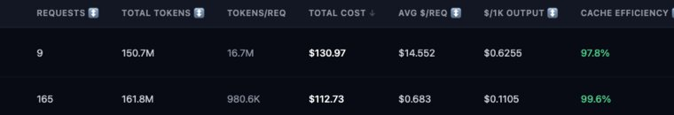

I've been running the two newest flagship models side by side in my daily workflow for a few weeks now. Not benchmark suites, not leaderboard prompts — actual work, mostly through Cursor. The conclusion I keep landing on is uncomfortable for anyone who's bought into the "you get what you pay for" narrative around frontier models: **Grok 4.7 and Opus 5.5 are effectively the same model to me, except one costs dramatically more.**

Neither one is a bad model. They're both excellent. That's precisely why the price difference matters.

### The Performance Reality

I want to be fair to Opus here, because it does have the stronger reputation for reasoning. And in my testing, Opus 5.5 does win some of the complex reasoning cases. Complex code reasoning, specifically.

But here's the thing: it wins them *by a hair.* Not by a margin that changes the outcome of a project. If Opus 5.5 is a 3% better reasoner than Grok 4.7 on the hardest problems, that advantage basically never surfaces in real work. It's the kind of edge that shows up in benchmark scores and evaporates when you're just trying to get a feature shipped without introducing a regression.

On speed, they're tied. I cannot tell the difference sitting in front of the editor. Both feel immediate, both stream responses at a pace where I'm waiting on my own thinking more than on the model.

On reasoning quality for ordinary and even complex software work — refactoring, debugging, architecture, multi-file changes — I genuinely cannot find a consistent winner. I've had sessions where Grok surprised me with a cleaner solution than I expected from it. I've had sessions where Opus did the same. Neither has been the clear day-to-day winner.

### The Only Difference That Matters: Cost

So if the models are effectively interchangeable on quality, speed, and reasoning in my workflow, what's left to compare?

The bill.

I pulled my actual usage dashboard for a recent stretch of Cursor work, and it tells the whole story:

Look at that top row — that's Opus 5.5. Nine requests. 150.7 million tokens. **$130.97.** Almost **$14.55 per request.**

Now look at the second row — Grok 4.7. **165 requests.** 161.8 million tokens. **$112.73.** About **$0.68 per request.**

Let me put that in perspective. For slightly *less* money, Grok handled **18 times more requests** than Opus. Eighteen. I got 165 productive sessions out of Grok for what Opus cost me in nine.

Per request, Opus runs about **21 times the price** of Grok on this usage. And the token volume is nearly identical — 150.7M vs 161.8M — so this isn't some quirk of one model burning tokens and the other being frugal. They consumed essentially the same amount of tokens doing the same class of work. The entire gap is sticker price per token, not efficiency.

The cache efficiency numbers are interesting too — 97.8% for Opus, 99.6% for Grok. Both are excellent, and both models are clearly designed for heavy prompt caching. Neither is wasting your money on redundant context. The difference is purely what Anthropic and xAI charge for the tokens they do bill.

### What "State of the Art" Actually Gets You

We've been trained to treat "state of the art" as a binary switch — as if there's one clearly-best model and everything else is a compromise. That framing breaks down the moment you look at real-world pricing for marginal gains.

If model A is 3% better on the hardest reasoning tasks but costs 20 times more per request, then for a working developer it's not actually the better tool. It's a luxury line item. The 3% edge is real, but it's not something you can point to in the work you produce. The 20x on your monthly bill, though? You notice that immediately.

This is the part the model-vs-model discourse keeps missing. When I see people insist that Opus is worth the premium, I don't think they're wrong that it's better. I think they're wrong that the difference is *usable.* The gap has narrowed so far that "the best model" and "a really good model" have converged for practical purposes — but their prices have not.

### The Verdict

Neither Grok 4.7 nor Opus 5.5 is a bad model. I'll actually say it plainly: both are excellent, and if you handed me either one in a vacuum I'd be happy with the work it produced.

But run them side by side for a few weeks, and the choice stops being about quality at all. On the dimensions that matter for my work — speed, cost, reasoning — they are effectively tied. The single biggest difference between them, the one I can actually measure and feel, is that Opus costs roughly an order of magnitude more per request.

For my workflow, that settles it. Grok 4.7 gives me the same output at a fraction of the price, and when the output is the same, the cheaper model is the better model.
